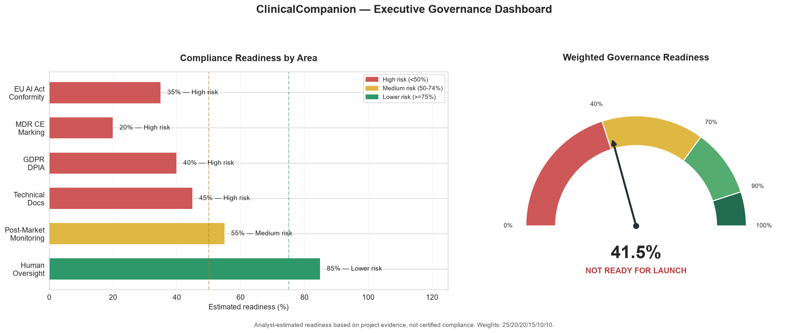
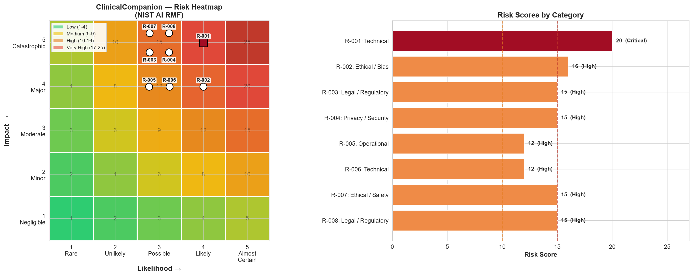
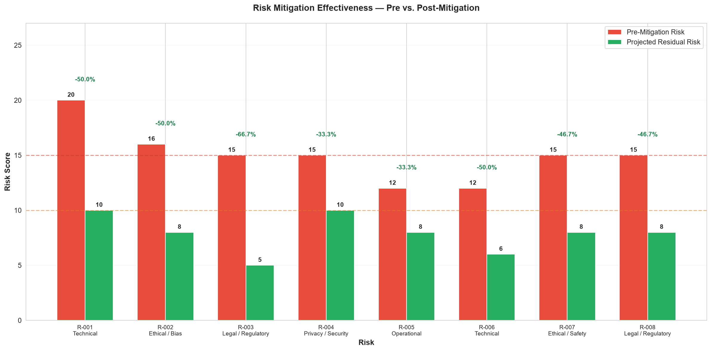
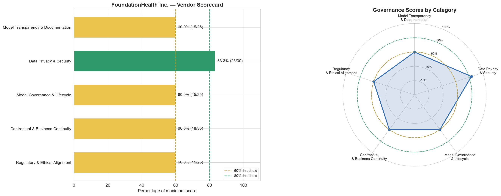
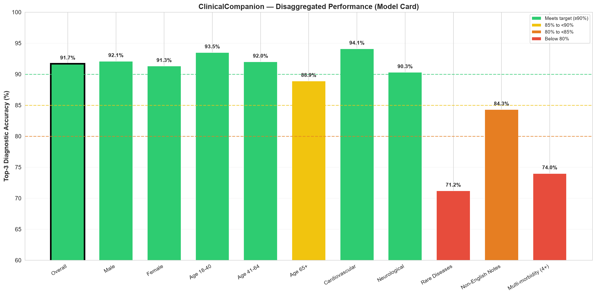
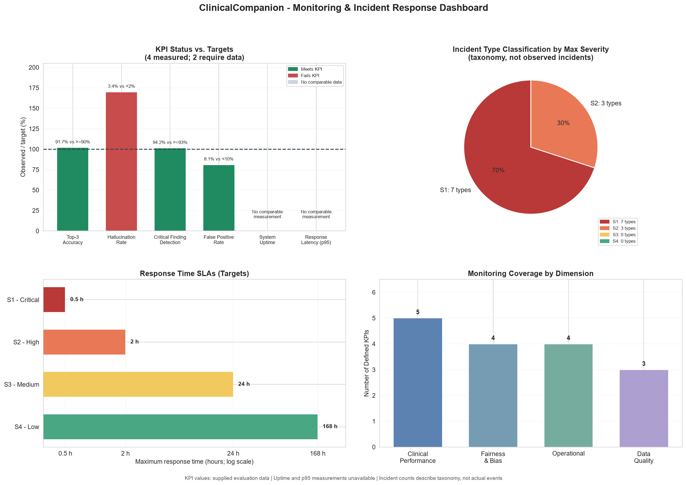

# ClinicalCompanion — Healthcare AI Governance & EU Launch Assessment

**Udacity Accenture Training | AI Governance, Risk & Compliance**

**Certificate:** [View AI Governance certificate](https://www.udacity.com/certificate/e/9f8ef37a-ae21-11f1-8f77-932c385c4d9c)

### EU AI Act · NIST AI RMF · Third-Party Risk · Model Cards · Clinical AI Safety

**A board-level AI governance assessment of a fictional generative AI clinical decision-support system preparing for the EU market, completed as part of my Udacity Accenture Training.**

**Decision:** **NO-GO for launch at present**

> **Executive conclusion:** Strong aggregate model performance is not sufficient for release when material clinical, regulatory, privacy, and supplier-governance risks remain unresolved. This assessment recommends deferring launch until the critical controls are verified and the responsible stakeholders approve the remaining risk.



---

## Executive overview

ClinicalCompanion is a simulated clinical decision-support system that analyzes patient records and provides diagnostic suggestions to physicians using a third-party foundation model. I examined the proposed EU launch through regulatory screening, risk scoring, vendor assurance, disaggregated model performance, and post-deployment monitoring.

| Assessment area | Key result | Interpretation |
| :--- | ---: | :--- |
| **EU AI Act gap analysis** | **14 / 16** | Outstanding requirements in the supplied assessment |
| **NIST AI RMF risk assessment** | **8 risks** | Govern, Map, Measure, and Manage |
| **Projected mitigation effect** | **47.5%** | Reduction in summed *scenario risk scores* if proposed controls work |
| **Third-party vendor assessment** | **65.2%** | Medium-risk score across 27 evaluation criteria |
| **Disaggregated diagnostic performance** | **4 subgroups** | Below the case's internal 90% Top-3 accuracy target |
| **Governance launch readiness** | **41.5%** | Illustrative weighted analyst estimate; **not** legal compliance |
| **Board recommendation** | **NO-GO** | Launch gates and control validation are not satisfied |

**The decision is driven by unresolved safety and compliance blockers, not simply the composite readiness percentage.**

## Explore the actual deliverables

| Deliverable | What you'll find |
| :--- | :--- |
| **[Python analysis notebook](starter/governance_assessment.ipynb)** | Data loading, classification checks, risk calculations, vendor scoring, subgroup analysis, and executable chart generation |
| **[Completed governance assessment workbook](starter/governance_workbook.xlsx)** | Six sheets: EU AI Act classification, Risk Register, Vendor Evaluation, Model Card, Monitoring & Incidents, Executive Summary |
| **[Six full-resolution charts](starter/results/)** | Risk, vendor, fairness, monitoring, and executive dashboard visualizations |
| **[Input datasets](starter/data/)** | Ten CSV/JSON files supplied with the educational case |
| **[Board decision brief](docs/board-decision-brief.md)** | Board recommendation, release gates, and evidence required |
| **[Risk-to-control map](docs/risk-control-traceability.md)** | How issues translate into verifiable governance controls |
| **[Methodology and limitations](docs/methodology-and-scope.md)** | Risk-score assumptions, evidence boundaries, and methodological limitations |

## Visual assessment gallery

### 01 — Risk identification and prioritization

A 5×5 likelihood–impact matrix positions the eight documented risks, while the adjoining chart compares their inherent scores. Clinical hallucinations (R-001) were the highest-scoring risk.

[](starter/results/risk_heatmap.png)

### 02 — Quantifying planned mitigation

Compare initial and *projected* residual scores by risk. The summed risk scores decline from 120 to 63 in the modeled scenario—**not** a demonstrated 47.5% reduction in patient harm.

[](starter/results/risk_mitigation_comparison.png)

### 03 — Foundation-model vendor governance

The fictional supplier is assessed across transparency, data privacy and security, model lifecycle governance, contractual continuity, and regulatory/ethical alignment. The composite score of **65.2%** supports **conditional rather than unconditional supplier approval**.

[](starter/results/vendor_evaluation_chart.png)

### 04 — Model Card and subgroup fairness

Overall Top-3 diagnostic accuracy reached **91.7%**, but four evaluated subgroups missed the 90% internal target. Rare Diseases (**71.2%**) and Multi-morbidity (4+) (**74.0%**) had especially significant gaps.

[](starter/results/model_card_performance.png)

### 05 — Monitoring and incident response

Four panels connect measured KPI performance, an incident *taxonomy*, severity-response targets, and KPI definition coverage. Missing uptime and p95 latency observations are clearly identified instead of invented.

[](starter/results/monitoring_dashboard.png)

### 06 — Executive readiness and decision

Six weighted readiness dimensions lead to an **illustrative 41.5% score** and a **NO-GO** recommendation pending clinical safety evidence, conformity assessment, privacy remediation, and validation of proposed controls.

[](starter/results/executive_dashboard.png)

---

## Governance approach

| Phase | Question | Approach and output |
| :--- | :--- | :--- |
| **1. System scoping** | What are we approving, and for whom? | Intended use, prohibited uses, third-party model dependency, source-data mix |
| **2. Regulatory screening** | Which obligations might apply? | Preliminary Article 5 / Article 6 assessment, MDR Rule 11 working hypothesis, EU AI Act gaps |
| **3. Risk assessment** | Where is the risk concentrated? | Eight risk records, 1–5 likelihood × impact scoring, NIST AI RMF grouping |
| **4. Mitigation design** | What would reduce risk? | Inherent vs. projected residual risk comparison; verification still required |
| **5. Third-party governance** | Is the vendor acceptable? | 27 criteria, evidence gaps, privacy and contractual issues |
| **6. Model performance** | Does accuracy hold across subgroups? | Disaggregated Top-3 accuracy, threshold shortfalls, fairness and safety implications |
| **7. Operational assurance** | Can we detect and respond to failure? | KPI definitions, S1–S4 incident severity targets, monitoring gaps |
| **8. Board assessment** | Is the system ready to launch? | Six-area readiness synthesis and conditional release gates |

## Findings that influenced the NO-GO decision

- **Clinical safety:** A case-reported **3.4% hallucination rate** exceeded the scenario's **2% internal ceiling**. Safety testing and mitigation evidence were insufficient for release.
- **Disaggregated accuracy:** Aggregate accuracy masked material subgroup gaps; an overall pass could not justify unrestricted clinical use.
- **Regulatory pathway:** High-risk status was assessed **provisionally** through the medical-device route; exact MDR classification and required third-party conformity evidence need qualified confirmation.
- **Supplier assurance:** A composite vendor score could not override incomplete documentation, transfer assessment, and contingency evidence.
- **Operational maturity:** The monitoring plan described KPIs and SLAs, but it was not equivalent to verified production monitoring and tested incident response.

## Running the notebook locally

The assessment is supplied as a reproducible learning project. Use Python 3.11 or a compatible Python 3.8+ environment.

```bash
git clone https://github.com/blackHunter27/ClinicalCompanion-AI-Governance-Assessment.git
cd ClinicalCompanion-AI-Governance-Assessment
python -m venv .venv
# Windows:
.venv\Scripts\python -m pip install -r starter/requirements.txt ipykernel
# macOS / Linux:
# .venv/bin/python -m pip install -r starter/requirements.txt ipykernel
```

Open **[starter/governance_assessment.ipynb](starter/governance_assessment.ipynb)** in VS Code with the Jupyter extension, select the new virtual environment as the notebook kernel, and run the cells in order. Charts are saved to **[starter/results/](starter/results/)**. The workbook can be opened in Excel.

## Frameworks and references

- [EU Artificial Intelligence Act — consolidated text](https://eur-lex.europa.eu/eli/reg/2024/1689)
- [NIST Artificial Intelligence Risk Management Framework](https://www.nist.gov/itl/ai-risk-management-framework)
- [EU Medical Devices Regulation (EU) 2017/745](https://eur-lex.europa.eu/eli/reg/2017/745/oj)
- [EU GDPR — Regulation (EU) 2016/679](https://eur-lex.europa.eu/eli/reg/2016/679/oj)

**Assessment note:** Regulatory classification, applicability and implementation timelines should be reviewed against current primary sources before use outside this instructional scenario.

---

## About this case study

**Portfolio author:** Mohamed Eldessouki · B.Eng. Computer Engineering (Cybersecurity).

**Provenance and disclosure:** ClinicalCompanion, MedAssist AI, and FoundationHealth Inc. are **fictional**, and the source data, task specification, and starter files come from the **Udacity Accenture Training** case study. The project was reviewed and passed. The repository does **not** represent independent production engineering, a live vendor audit, a real clinical system, or a professional conformity assessment. All figures and thresholds describe the supplied simulated case.

---

**Core takeaway:** *AI governance is not only about checking a framework. It is about connecting regulatory obligations, credible evidence, measured performance, control effectiveness, supplier accountability, and a defensible release decision.*
